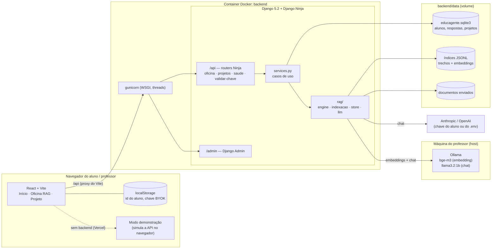
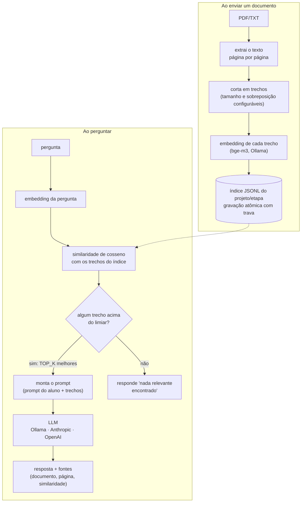

# Educagente

Plataforma da oficina **"Inclusão Digital e Profissão em Ciência da Computação através do RAG
Agêntico"**, projeto de extensão da UCDB (Campo Grande/MS). "Educagente" vem de "educa a gente".

## Objetivo

Levar inclusão digital e uso crítico de IA a alunos do Ensino Médio de escolas públicas, sem exigir
conhecimento técnico prévio. Em oficinas curtas (30 a 60 min), em laboratórios de informática com
computadores antigos, o aluno monta o próprio chatbot e descobre na prática que:

- a IA responde com base no que recebe, e por isso pode "inventar" ou repetir informação errada;
- dá para controlar a resposta com instruções (prompt) e com documentos (RAG);
- toda resposta com RAG mostra **de qual documento e de qual página** veio a informação, e quando
  nada é relevante a plataforma diz isso em vez de forçar uma resposta.

Também apresenta a computação como profissão possível. O professor acompanha as respostas da turma
e exporta os dados para a pesquisa do projeto de extensão.

## Os dois fluxos

### Oficina RAG (fixo, 3 etapas)

O aluno faz a mesma pergunta em três etapas e compara as respostas:

| Etapa | O que acontece |
|---|---|
| 1 · IA sem RAG | A LLM responde só com o que aprendeu no treino |
| 2 · RAG com dados errados | O aluno envia um PDF/TXT com informação falsa e pergunta de novo |
| 3 · RAG com dados corretos | O aluno envia o PDF/TXT correto e pergunta de novo |

A tela **Comparar** mostra as três respostas lado a lado. A tela **Pesquisa** (professor) lista as
respostas de todos os alunos e exporta CSV.

### Projeto (livre, aba "Projeto")

O aluno cria até 3 projetos e, em cada um, passa por cinco telas: **Prompt** (persona, contexto,
instrução, restrição e formato de saída) → **Conhecimento** (envio de documentos) → **Conversar** →
**Comparar** (modelo puro × +prompt × +prompt+RAG) → **Exportar** (zip com configuração, documentos
e o prompt final).

Cada projeto escolhe o provedor de IA na criação:

- **Ollama**: grátis e sem conta, usa o servidor Ollama da turma.
- **Anthropic** / **OpenAI**: o aluno usa a própria chave (*bring your own key*), colada na tela
  **"Minha IA"**. A chave fica só no navegador e viaja por requisição direto para o provedor;
  nunca vai para o banco nem para log. O botão "Como conseguir?" explica onde criar a chave.

Não há "Entrar com Anthropic/OpenAI" via OAuth: nenhum dos dois oferece um login de terceiros que
libere o uso da API pela conta do aluno. Colar a chave é o caminho disponível.

## Arquitetura



O frontend nunca fala direto com a IA: tudo passa pela API. O núcleo `rag/` não depende de Django
nem de HTTP; os `services.py` de cada app chamam o núcleo, e as rotas só validam a entrada e
devolvem JSON.

### Caminho de uma pergunta com RAG



A função central é `rag/engine.py::run(config, index, question, use_prompt, use_rag, api_key)`. As três
camadas da comparação são a mesma função com `use_prompt` e `use_rag` ligados ou desligados.

## Stack

| Camada | Tecnologia |
|---|---|
| Frontend | React 19, Vite 8, TypeScript 6, Tailwind 4, `motion`, `lucide-react`, `next-themes` |
| API | Django 5.2 LTS + Django Ninja 1.7 (validação Pydantic e OpenAPI automática) |
| Servidor | gunicorn (WSGI, com threads porque cada pergunta espera a LLM) + whitenoise (estáticos do admin) |
| Banco | SQLite via ORM e migrations do Django |
| RAG | índice próprio em JSONL + similaridade de cosseno com numpy; extração de PDF com `pypdf` |
| Embeddings | `bge-m3` (multilíngue) via Ollama, sempre local |
| Chat | Ollama (`llama3.2:1b`), Anthropic ou OpenAI, por adaptadores plugáveis |
| Infra | Docker Compose para a API; Ollama no host; frontend no Vite (laboratório) ou na Vercel (demonstração) |
| Testes | test runner do Django, com Ollama e provedores simulados |

## Estrutura do repositório

```
educagente/
├── frontend/                   site (React + Vite)
│   └── src/
│       ├── App.tsx             cabeçalho, navegação e página Início (apresentação à banca)
│       ├── telas.tsx           Oficina RAG: etapas 1-3, Comparar, Pesquisa
│       ├── telasProjeto.tsx    fluxo Projeto (identidade visual "Pantanal")
│       ├── components/         unlumen-ui (Início/Etapas) e pantanal.tsx (Projeto)
│       └── lib/                api.ts, apiProjeto.ts, chavesIA.ts (BYOK), demo.ts (modo demonstração)
├── backend/                    API (Django + Django Ninja)
│   ├── educagente/             settings, urls, montagem da API e erros → 400/404/502
│   ├── oficina/                Aluno, Resposta, 3 etapas, painel do professor, importação do banco antigo
│   ├── projetos/               Projeto, documentos, respostas, comparação e exportação
│   ├── rag/                    núcleo RAG: engine, indexacao, ingestion, chunking, store, llm, embeddings
│   ├── tests/                  testes da API, do isolamento entre alunos e da importação
│   ├── data/                   banco, índices e documentos (fora do git)
│   ├── Dockerfile, entrypoint.sh
│   └── requirements.txt, .env.example
├── docker-compose.yml          serviço "api", volume backend/data, acesso ao Ollama do host
├── docker-up.sh                sobe a API em Docker (gera a secret key e ajusta o Ollama)
├── ollama.sh                   deixa o Ollama do host acessível ao container
├── iniciar.sh                  modo local, sem Docker (API + site)
├── testar-api.sh               teste de fumaça de todas as rotas
├── PRODUCT.md                  público, propósito e restrições do produto
└── DESIGN.md                   identidade visual "Pantanal" do fluxo Projeto
```

## Como subir

### Pré-requisitos

- **Docker** com Docker Compose (para a API);
- **Ollama** instalado no host ([ollama.com](https://ollama.com/download));
- **Node.js** e npm (para o frontend).

### 1. Modelos do Ollama (só na primeira vez)

```bash
./ollama.sh                 # deixa o Ollama escutando em 0.0.0.0 (idempotente)
ollama pull bge-m3          # embedding, sempre necessário
ollama pull llama3.2:1b     # chat, se MODEL_PROVIDER=ollama
```

### 2. Variáveis de ambiente e chaves de API

Toda a configuração do backend fica em `backend/.env`. Crie o arquivo a partir do modelo:

```bash
[ -f backend/.env ] || cp backend/.env.example backend/.env
```

O `.env` está no `.gitignore`: **nunca commite esse arquivo** nem cole chaves em issues, prints ou
no chat.

#### 2.1 Django (obrigatório)

| Variável | Docker (`./docker-up.sh`) | Local (`./iniciar.sh`) |
|---|---|---|
| `DJANGO_DEBUG` | `0` (já vem assim no modelo) | o script define `1` sozinho |
| `DJANGO_SECRET_KEY` | gerada automaticamente se estiver vazia | opcional: com `DEBUG=1` há uma chave só de desenvolvimento |
| `DJANGO_ALLOWED_HOSTS` | `localhost,127.0.0.1` basta, inclusive no laboratório | idem |

Sem Docker e com `DJANGO_DEBUG=0`, gere a chave você mesmo:

```bash
echo "DJANGO_SECRET_KEY=$(python3 -c 'import secrets; print(secrets.token_urlsafe(50))')" >> backend/.env
```

#### 2.2 Provedor de IA da Oficina RAG (escolha um)

`MODEL_PROVIDER` e `LLM_MODEL` definem o modelo que responde nas 3 etapas da Oficina RAG. Os dois
precisam combinar: o modelo vem como `claude-haiku-5-5`, então ao trocar o provedor **troque também
o `LLM_MODEL`**.

**Opção A: Ollama (grátis, sem chave, recomendada para testar)**

```env
MODEL_PROVIDER=ollama
LLM_MODEL=llama3.2:1b
```

**Opção B: Anthropic (Claude)**

```env
MODEL_PROVIDER=anthropic
LLM_MODEL=claude-haiku-5-5
ANTHROPIC_API_KEY=sk-ant-...
```

Para criar a chave, entre em `console.anthropic.com` → **API Keys** → **Create Key**. É a conta de
desenvolvedor, diferente da conta do app Claude, e precisa de créditos.

**Opção C: OpenAI**

```env
MODEL_PROVIDER=openai
LLM_MODEL=gpt-4o-mini
OPENAI_API_KEY=sk-...
```

Para criar a chave, entre em `platform.openai.com` → **API keys** → **Create new secret key**. A
cobrança da API é separada da assinatura do ChatGPT.

Se o provedor escolhido for Anthropic ou OpenAI e a chave estiver vazia, a Oficina RAG não quebra:
entra em **modo demonstração** e mostra os trechos encontrados no lugar da resposta da IA. O
`/api/saude` indica isso com `"llm_configurada": false`.

#### 2.3 Ollama e busca (já vêm prontos)

| Variável | Valor | Quando mexer |
|---|---|---|
| `OLLAMA_HOST` | `http://localhost:11434` | só se o Ollama estiver em outra máquina ou porta; no Docker o `docker-compose.yml` já troca por `http://host.docker.internal:11434` |
| `EMBEDDING_MODEL` | `bge-m3` | não precisa; é usado sempre, qualquer que seja o provedor de chat |
| `TOP_K` | `4` | para usar mais ou menos trechos por pergunta |
| `SIMILARITY_THRESHOLD` | `0.5` | para deixar a busca mais exigente (maior) ou mais permissiva (menor) |

O Ollama é sempre necessário, mesmo com Anthropic ou OpenAI no chat, porque os embeddings são
calculados localmente.

#### 2.4 Chaves no fluxo Projeto (não vão no `.env`)

No fluxo Projeto, cada projeto escolhe o provedor na criação, com um modelo fixo por provedor:
`llama3.2:1b` (Ollama), `claude-haiku-5-5` (Anthropic) e `gpt-4o-mini` (OpenAI). O `LLM_MODEL` não
afeta os projetos.

- Projetos **Ollama** não precisam de chave.
- Projetos **Anthropic/OpenAI** usam a chave que o aluno cola na tela **"Minha IA"**. Ela fica no
  `localStorage` do navegador e vai no header `X-Provider-Api-Key` a cada pergunta. Se o aluno não
  tiver chave, a API usa a `ANTHROPIC_API_KEY`/`OPENAI_API_KEY` do `.env` como chave da turma. Sem
  nenhuma das duas, a pergunta responde 400 pedindo a chave.

Para testar uma chave pela API sem gastar tokens:

```bash
curl -s -X POST http://localhost:8000/api/validar-chave -H 'Content-Type: application/json' \
  -d '{"provider": "anthropic", "api_key": "sk-ant-..."}'
# {"ok": true}  ou  {"ok": false, "erro": "..."}
```

#### 2.5 Frontend (opcional)

O frontend não precisa de `.env`. A única variável é `VITE_MODO=demo`, que força o modo demonstração
mesmo com a API no ar (útil para ensaiar a apresentação):

```bash
cd frontend && VITE_MODO=demo npm run dev
```

#### 2.6 Aplicar e conferir

O `.env` só é lido quando a API sobe. Depois de editar, reinicie:

```bash
docker compose up -d --force-recreate api      # Docker
# ou Ctrl+C e ./iniciar.sh de novo             # local

curl -s http://localhost:8000/api/saude
# {"ok": true, "provedor": "ollama", "modelo": "llama3.2:1b", "llm_configurada": true}
```

`provedor` e `modelo` devem mostrar o que você configurou, e `llm_configurada` deve ser `true`.

### 3. API em Docker

```bash
./docker-up.sh
```

O script gera a `DJANGO_SECRET_KEY` se estiver vazia, chama o `ollama.sh`, roda
`docker compose up --build -d` e espera a API responder. Ao subir, o container roda `migrate`,
`importar_banco_legado` e o gunicorn. Para conferir:

```bash
docker compose ps                        # STATUS deve mostrar "healthy"
curl http://localhost:8000/api/saude
# {"ok": true, "provedor": "ollama", "modelo": "llama3.2:1b", "llm_configurada": true}
docker compose logs -f api               # logs
```

| Endereço | O que é |
|---|---|
| `http://localhost:8000/api/docs` | documentação interativa (Swagger) |
| `http://localhost:8000/api/saude` | status da API |
| `http://localhost:8000/admin/` | Django Admin |

A raiz `http://localhost:8000/` responde 404 de propósito: só existem `/api/` e `/admin/`.

### 4. Frontend

```bash
cd frontend && npm install && npm run dev
```

Abre em `http://localhost:5173`. O Vite repassa `/api` para `localhost:8000`, então o site funciona
igual com a API no Docker ou no host.

### Alternativa sem Docker

```bash
./iniciar.sh
```

Modo local (`DJANGO_DEBUG=1`, `runserver`): cria um ambiente Python em `backend/.venv`, instala as
dependências, roda as migrations e sobe a API (porta 8000) e o site (porta 5173) juntos.

### No laboratório

O Vite já escuta na rede. Rode tudo no computador do professor e os alunos acessam
`http://IP-DO-PROFESSOR:5173`. As chamadas `/api` passam pelo Vite (com `changeOrigin`), então não é
preciso mexer em CORS nem em `DJANGO_ALLOWED_HOSTS`.

### Derrubar

```bash
docker compose down        # API
# Ctrl+C no terminal do npm run dev (frontend)
```

## Como testar

### Teste de fumaça (API no ar)

```bash
./testar-api.sh
```

Cria um aluno de teste e passa por todas as rotas: as 3 etapas da Oficina RAG, a comparação, o fluxo
Projeto (criar, ajustar o prompt, enviar documento, perguntar, comparar as 3 camadas, exportar) e o
isolamento (outro aluno recebe 404 no projeto). Para no primeiro erro e mostra a resposta da API.
Os alunos de teste ficam no banco e podem ser apagados pelo `/admin`.

### Testes automatizados

```bash
docker compose run --rm --no-deps api python manage.py test tests
```

Usam Ollama e provedores de IA simulados: nenhuma chamada real ou paga.

### Na mão

No navegador, `http://localhost:8000/api/docs` lista todas as rotas com o formato de entrada e
saída, e o botão "Try it out" executa cada uma. Com curl:

```bash
API=http://localhost:8000/api

# Oficina RAG
curl -s -X POST $API/alunos -H 'Content-Type: application/json' \
  -d '{"apelido": "teste", "turma": "lab", "consentimento": true}'
ALUNO=1   # troque pelo "id" devolvido

curl -s -X POST $API/alunos/$ALUNO/perguntar -H 'Content-Type: application/json' \
  -d '{"etapa": 1, "pergunta": "O que é RAG?"}'

echo "RAG significa Retrieval-Augmented Generation: busca trechos e passa para a LLM." > rag.txt
curl -s -X POST $API/alunos/$ALUNO/documentos -F etapa=3 -F arquivo=@rag.txt
curl -s -X POST $API/alunos/$ALUNO/perguntar -H 'Content-Type: application/json' \
  -d '{"etapa": 3, "pergunta": "O que é RAG?"}'
curl -s $API/alunos/$ALUNO/comparacao

# Projeto
curl -s -X POST $API/alunos/$ALUNO/projetos -H 'Content-Type: application/json' \
  -d '{"nome": "Meu projeto", "model_provider": "ollama"}'
PROJ=1    # troque pelo "id" devolvido

curl -s -X POST $API/alunos/$ALUNO/projetos/$PROJ/documentos -F arquivo=@rag.txt
curl -s -X POST $API/alunos/$ALUNO/projetos/$PROJ/comparar -H 'Content-Type: application/json' \
  -d '{"pergunta": "O que é RAG?"}'
```

### Rotas

| Método | Rota | O que faz |
|---|---|---|
| GET | `/api/saude` | status da API e do provedor de IA |
| POST | `/api/validar-chave` | testa uma chave Anthropic/OpenAI sem gastar tokens e sem guardar |
| POST | `/api/alunos` | cria o aluno (apelido, turma, consentimento) |
| GET | `/api/alunos/{id}` | dados do aluno e trechos indexados por etapa |
| POST | `/api/alunos/{id}/documentos` | envia o PDF/TXT de uma etapa (form: `etapa`, `arquivo`) |
| POST | `/api/alunos/{id}/perguntar` | pergunta em uma etapa (`etapa`, `pergunta`) |
| GET | `/api/alunos/{id}/respostas` | respostas do aluno |
| GET | `/api/alunos/{id}/comparacao` | respostas agrupadas por pergunta, etapa por etapa |
| GET, POST | `/api/alunos/{id}/projetos` | lista ou cria projetos |
| GET, PATCH | `/api/alunos/{id}/projetos/{pid}` | vê ou atualiza (prompt, trechos, `top_k`, limiar) |
| POST | `/api/alunos/{id}/projetos/{pid}/documentos` | envia documento ao projeto (form: `arquivo`) |
| POST | `/api/alunos/{id}/projetos/{pid}/perguntar` | pergunta com prompt + RAG |
| POST | `/api/alunos/{id}/projetos/{pid}/comparar` | pergunta nas 3 camadas: puro, prompt, prompt+RAG |
| GET | `/api/alunos/{id}/projetos/{pid}/comparacoes` | histórico de comparações |
| GET | `/api/alunos/{id}/projetos/{pid}/exportar` | zip do projeto |
| GET | `/api/professor/respostas` | todas as respostas da Oficina RAG |
| GET | `/api/professor/export.csv` | CSV para a pesquisa |

Projetos Anthropic/OpenAI recebem a chave do aluno no header `X-Provider-Api-Key`. Erros vêm sempre
como `{"detail": "..."}`: **400** (entrada inválida), **404** (aluno ou projeto inexistente, ou
projeto de outro aluno) e **502** (Ollama ou provedor fora do ar).

## Configuração

Variáveis de `backend/.env` (modelo em `backend/.env.example`):

| Variável | Padrão | Para que serve |
|---|---|---|
| `DJANGO_DEBUG` | `0` | `1` no modo local (`./iniciar.sh` já define) |
| `DJANGO_SECRET_KEY` | vazia | obrigatória com `DJANGO_DEBUG=0`; o `docker-up.sh` gera uma |
| `DJANGO_ALLOWED_HOSTS` | `localhost,127.0.0.1` | hosts aceitos |
| `MODEL_PROVIDER` | `anthropic` | chat da Oficina RAG: `anthropic`, `openai` ou `ollama` |
| `ANTHROPIC_API_KEY`, `OPENAI_API_KEY` | vazias | chave da turma (fallback); sem ela, a Oficina roda em modo demonstração |
| `LLM_MODEL` | `claude-haiku-5-5` | modelo de chat (ex.: `llama3.2:1b` no Ollama) |
| `OLLAMA_HOST` | `http://localhost:11434` | no Docker, o compose troca por `host.docker.internal` |
| `EMBEDDING_MODEL` | `bge-m3` | modelo de embedding |
| `TOP_K` | `4` | quantos trechos usar por pergunta |
| `SIMILARITY_THRESHOLD` | `0.5` | similaridade mínima; abaixo disso, "nada relevante encontrado" |

As chaves do `.env` ficam só no servidor e valem para a turma toda. No fluxo Projeto, cada aluno
normalmente usa a própria chave pela tela "Minha IA".

## Operação

### Painel do professor

O Django Admin (`http://localhost:8000/admin`) mostra alunos, respostas, projetos e documentos, com
login. Crie o usuário uma vez:

```bash
docker compose exec api python manage.py createsuperuser
```

### Banco de dados e migração da versão FastAPI

O banco é `backend/data/educagente.sqlite3`. O banco da versão anterior (`backend/data/oficina.db`)
**não é alterado**: o comando `importar_banco_legado` copia os dados para o banco novo **mantendo os
ids**, então índices, pastas de projeto e o aluno salvo no navegador continuam válidos. Antes da
primeira cópia ele faz backup em `backend/data/backups/`. Rodar de novo não duplica nada, e no fim
ele imprime `legado=N django=N` por tabela. O container já roda o comando ao subir.

Para voltar à versão anterior basta voltar o código: o `oficina.db` continua intacto.

### Problema comum

Upload ou pergunta com erro 502 citando "Failed to connect to Ollama" quase sempre é o Ollama do
host reiniciado sem a configuração de rede (por exemplo, depois de um reboot). Rode `./ollama.sh` de
novo.

### Publicar na Vercel (só para apresentar)

Na Vercel roda só o site. Sem backend, ele entra sozinho em **modo demonstração**: busca e respostas
são simuladas no navegador, com os mesmos passos do RAG de verdade, e cada visitante vê só os
próprios dados.

1. Em vercel.com → **Add New → Project**, importe este repositório.
2. Em **Root Directory**, escolha `frontend` (o preset Vite é detectado sozinho).
3. Clique em **Deploy**.

O botão **Demonstração em 1 clique** roda as três etapas com exemplos prontos e abre a comparação.

## Interface

- **Início**: apresentação do projeto à banca (estatísticas de IA, como funcionam LLM e RAG,
  equipe), com componentes do [unlumen UI](https://ui.unlumen.com) e paleta azul/amarelo/rosa/verde.
- **Oficina RAG**: mesma linguagem visual da Início; menu com Etapa 1-3, Comparar e Pesquisa.
- **Projeto**: identidade própria "Pantanal" (Baloo 2 + IBM Plex Mono, ficha catalográfica, régua de
  similaridade), descrita em [`DESIGN.md`](DESIGN.md). Não compartilha estilo com a Início.

## LGPD

O aluno entra só com apelido e turma e precisa marcar o consentimento; não há outros dados pessoais.
A chave de IA colada em "Minha IA" fica no navegador, viaja no header `X-Provider-Api-Key` só nas
chamadas à LLM e não vai para banco, histórico, exportação nem log. Para apagar tudo, remova
`backend/data/`.

## Limitações conhecidas

- Não há login de aluno: ele é identificado pelo id salvo no navegador, e as rotas
  `/api/professor/*` são abertas. Para uso fora da rede do laboratório, o próximo passo é exigir login
  de staff nessas rotas (o Django Admin já tem).
- Projeto Anthropic/OpenAI sem chave (nem do aluno nem do `.env`) responde 400 pedindo a chave em
  "Minha IA". O modo demonstração vale só para a Oficina RAG quando o servidor não tem provedor.
- Mudar o tamanho dos trechos de um projeto não reindexa os documentos já enviados (reenvie-os).
- Sem GPU nos laboratórios, a camada com RAG demora mais; o tempo de resposta é mostrado, não
  escondido.
