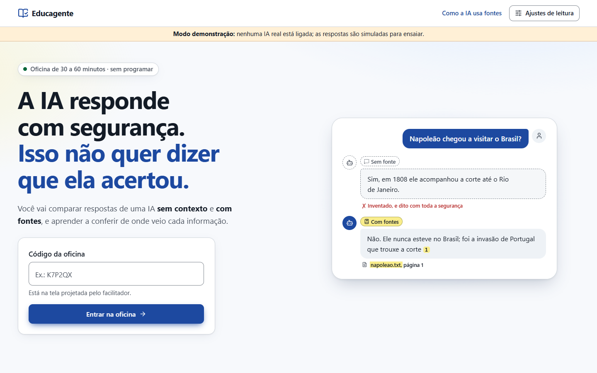
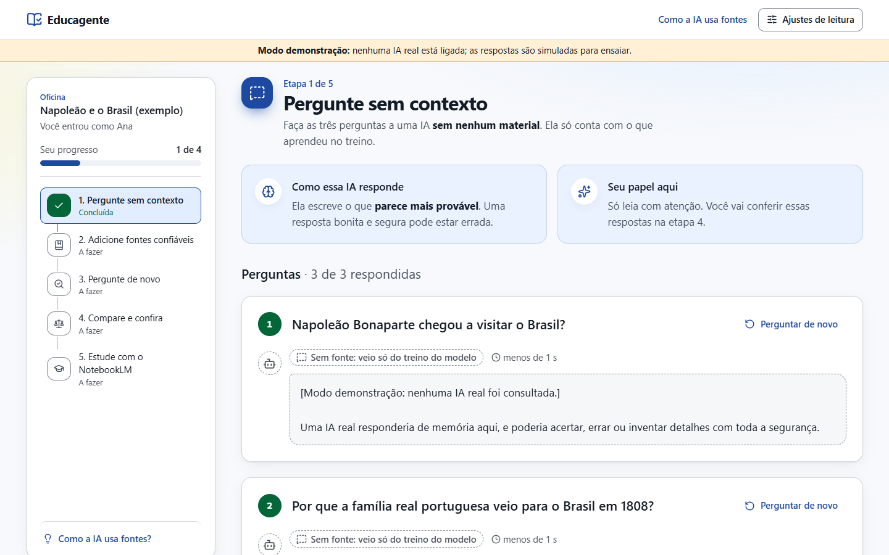
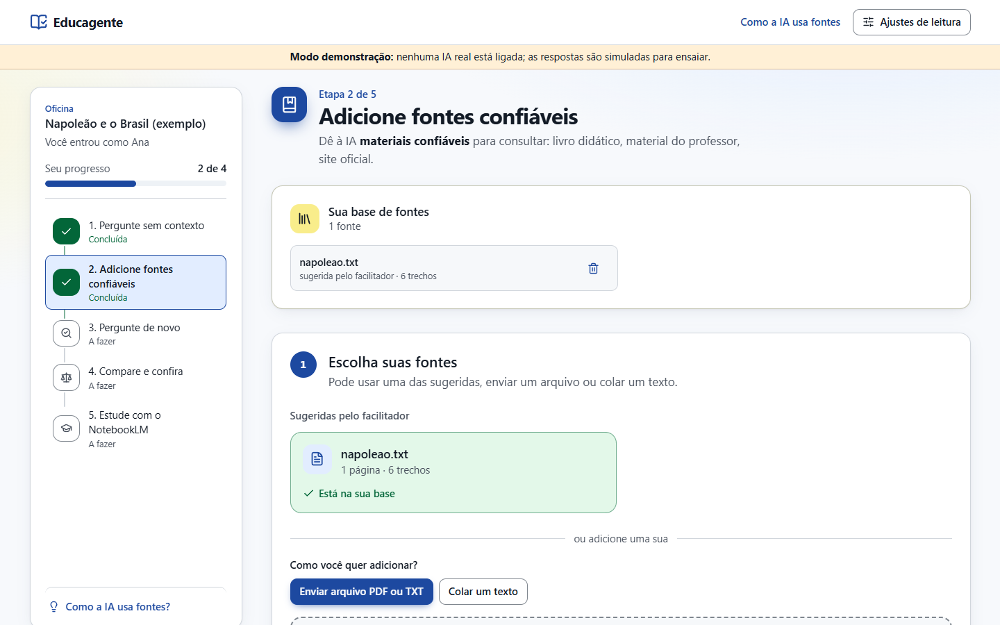
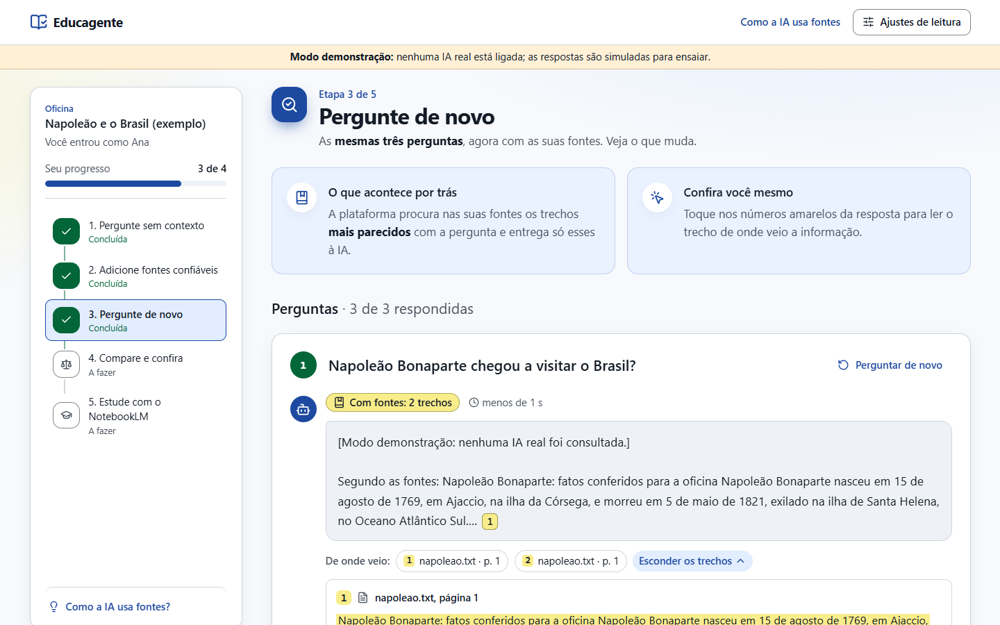
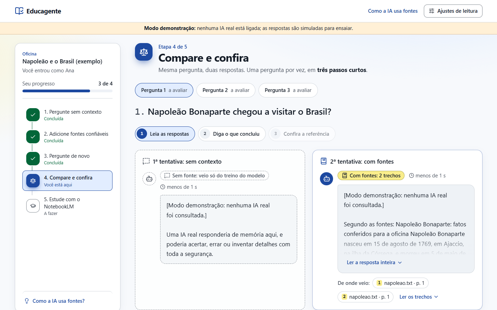
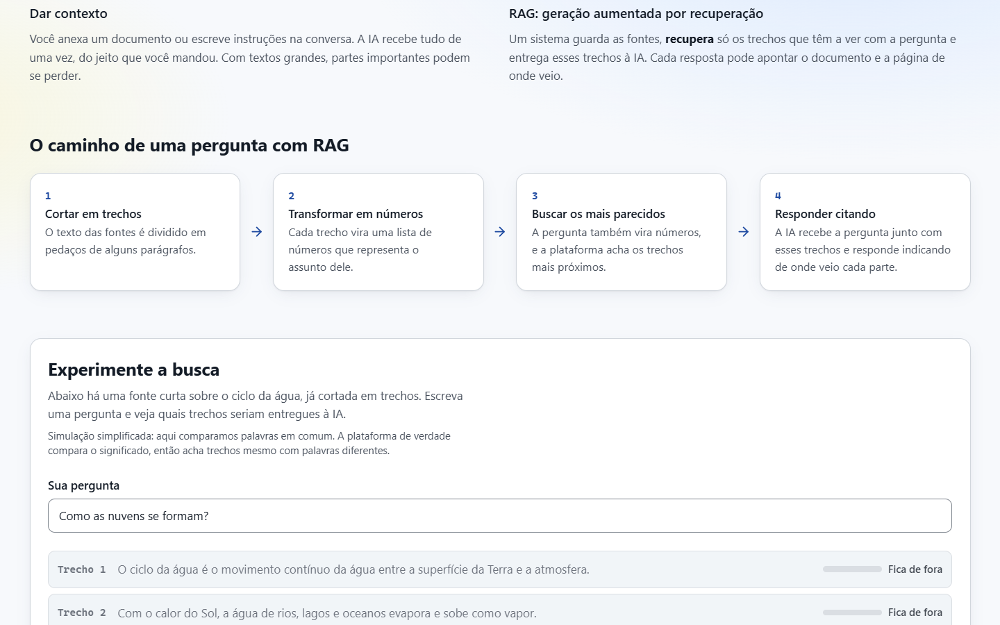
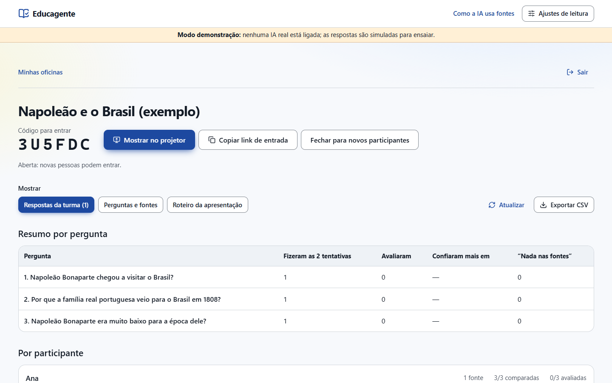
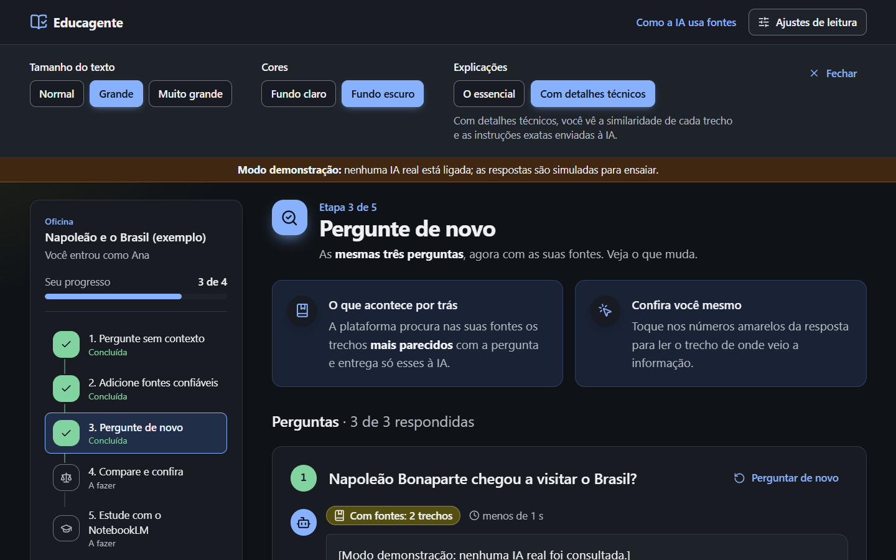
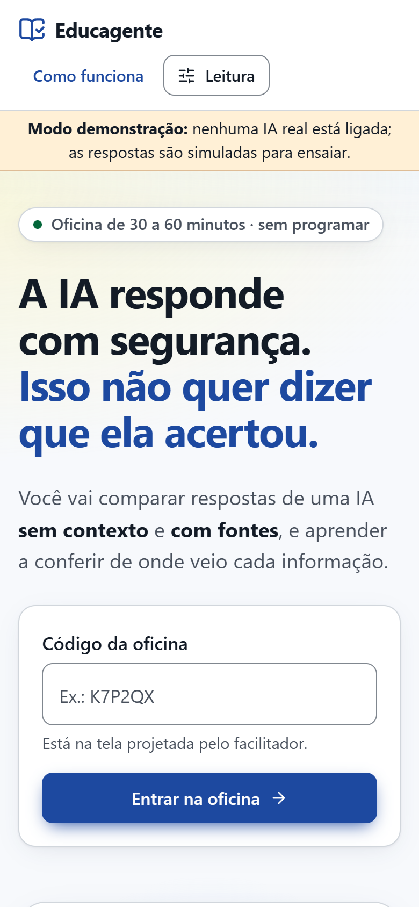
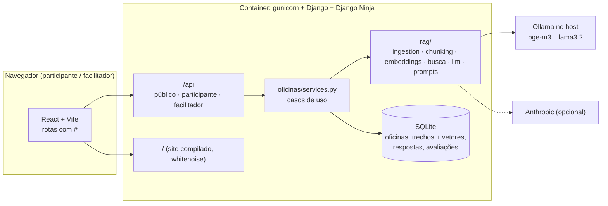

# Educagente


Plataforma da oficina **"Inclusão digital crítica: uso consciente de IA com RAG e NotebookLM"**
(Projeto DAC). Mostra, na prática, que uma IA pode responder com segurança e estar errada, e
que fontes confiáveis e verificação mudam o resultado. Público: adolescentes e adultos, sem
conhecimento técnico, em oficinas de 30 a 60 minutos.



**Sumário:** [O que a pessoa faz](#o-que-a-pessoa-faz) · [Telas](#telas) ·
[Privacidade e segurança](#privacidade-e-segurança) · [Arquitetura](#arquitetura) ·
[Como subir](#como-subir) · [Guia do código](docs/GUIA-DO-CODIGO.md)

## O que a pessoa faz

| Etapa | Atividade | O que aprende |
|---|---|---|
| 1 · Sem contexto | Faz as **três perguntas** da oficina a uma IA com configuração já definida pela equipe, sem materiais | Uma resposta convincente pode estar errada ou sem como ser conferida |
| 2 · Fontes | Adiciona fontes confiáveis (sugeridas pelo facilitador, PDF/TXT próprio ou texto colado) e, se quiser, orienta a IA | O papel do contexto, das instruções e da qualidade das fontes |
| 3 · Com fontes | Repete as **mesmas três perguntas**; cada resposta cita documento e página | Como o RAG recupera trechos; "não encontrei nas fontes" é uma resposta válida |
| 4 · Comparar | Vê as duas respostas lado a lado, avalia cada uma e diz em qual confiaria; depois vê a resposta de referência do facilitador | Conferir respostas e fontes; os limites da IA |
| 5 · NotebookLM | Passo a passo para estudar com documentos no NotebookLM (exemplo: função exponencial) | Levar o mesmo raciocínio para o estudo do dia a dia |

A página **"Como a IA usa fontes"** explica, em linguagem acessível, a diferença entre dar
contexto e RAG, o caminho de uma pergunta (trechos → embeddings → busca → resposta citando) e
tem uma simulação interativa da busca.

### Para adolescentes e adultos

Em **Ajustes de leitura** cada pessoa escolhe o tamanho do texto (normal, grande, muito
grande), fundo claro ou escuro e o nível das explicações: **o essencial** ou **com detalhes
técnicos** (similaridade de cada trecho, instruções exatas enviadas à IA, termos como
embedding e cosseno). A oficina é dividida em cinco etapas curtas, com o estado de cada uma
escrito na trilha lateral, e nada depende só de cor.

### O facilitador

Entra com a senha definida no servidor e:

- cria a oficina com **exatamente três perguntas** e, para cada uma, uma resposta de
  referência com a fonte (o participante só vê depois de avaliar sozinho);
- envia **fontes sugeridas** (PDF/TXT conferidos) que os participantes adicionam com um clique;
- mostra o **código de 6 letras** em tela cheia no projetor e fecha a oficina quando todos entraram;
- acompanha as respostas e avaliações da turma (atualiza sozinho) e **exporta CSV** para a pesquisa;
- tem o **roteiro da apresentação de 10 minutos** e os cuidados antes de começar.

`python manage.py criar_oficina_exemplo` cria uma oficina pronta sobre direitos na internet
(LGPD e Marco Civil da Internet: três perguntas, referências e uma fonte com os trechos das leis)
para ensaiar. O tema é de propósito: sem contexto, um modelo pequeno erra prazos e valores
(diz que a operadora guarda os registros de conexão por 6 meses; a lei diz 1 ano).

## Telas

As capturas abaixo são do modo demonstração (sem IA real ligada); com Ollama ou Anthropic, as
respostas são escritas pelo modelo.

| | |
|---|---|
|  |  |
| **Etapa 1:** as três perguntas sem contexto, com a barra de progresso fixa à esquerda | **Etapa 2:** fontes sugeridas, envio de PDF/TXT ou texto colado, e a orientação para a IA |
|  |  |
| **Etapa 3:** a resposta cita documento e página; o trecho aparece com marca-texto | **Etapa 4:** uma pergunta por vez, em três passos: ler, avaliar e conferir a referência |
|  |  |
| **Como a IA usa fontes:** contexto × RAG e uma simulação da busca | **Facilitador:** código para o projetor, respostas da turma e CSV |
|  |  |
| **Ajustes de leitura:** texto maior, fundo escuro e detalhes técnicos | **Celular:** a mesma oficina em tela pequena |

## Privacidade e segurança

- O participante informa só um **apelido** e aceita um termo explícito. Ele recebe um token
  aleatório (guardado no navegador; no banco fica só o hash). Não há ids sequenciais nas URLs.
- O participante pode **apagar todos os seus dados** no fim da oficina; o facilitador também
  pode apagar um participante ou a oficina inteira.
- Os arquivos enviados **não são guardados**: só o texto extraído, cortado em trechos, e os
  embeddings, no SQLite.
- Painel do facilitador protegido por senha (`FACILITADOR_SENHA`), token assinado com validade
  de 12 h, guardado só na aba (`sessionStorage`). Login limitado a 5 tentativas por minuto.
- Limites: arquivos até 5 MB e 60 páginas, 6 fontes por pessoa, 15 perguntas por minuto por
  participante.

## Arquitetura



- `rag/` não depende de Django: extração de PDF/TXT em memória, corte em trechos por
  parágrafo, embeddings (`ollama` com bge-m3, ou `local` para demonstração), busca por cosseno
  com limiar e adaptadores de chat (Ollama, Anthropic, demonstração).
- Quando nenhum trecho passa do limiar, a IA **não é chamada**: a plataforma responde que as
  fontes não falam do assunto.
- Os vetores ficam no SQLite (sem arquivo de índice nem trava de arquivo), então funciona igual
  em Linux, macOS e Windows, e apagar um participante apaga tudo dele.

```
backend/
  educagente/   settings, urls (API + site), erros → 400/404/503
  oficinas/     models.py, services.py (regras), api.py (rotas), schemas.py (entrada/saída),
                exportacao.py (CSV), exemplos/, comando de exemplo
  rag/          núcleo RAG sem Django: ingestion, chunking, embeddings, busca, prompts, llm
  tests/        fluxo, segurança/isolamento e núcleo RAG (sem chamar IA de verdade)
frontend/src/
  App.tsx       cabeçalho, avisos e rotas
  paginas/      Inicio, Entrar, Oficina (+ oficina/ etapas), ComoFunciona, facilitador/
  components/   ui.tsx, classes.ts, RespostaIA.tsx, Trilha.tsx, Etapa.tsx, Cabecalho.tsx
  lib/          api.ts, rota.ts, etapas.ts, preferencias.ts, utils.ts
docs/
  GUIA-DO-CODIGO.md   cada parte explicada: entrada, saída, banco, modelo, segurança e FAQ
```

**Para entender o código por dentro, leia o [Guia do código](docs/GUIA-DO-CODIGO.md).**

## Como subir

### Linux em um comando

```bash
git clone https://github.com/Magnumja/rag-oficina.git && cd rag-oficina
./instalar-linux.sh                          # rede local: http://IP:8000
./instalar-linux.sh oficina.seudominio.com   # internet com HTTPS (DNS já apontando)
```

Gera a chave do Django e a senha do professor na própria máquina, preenche o `backend/.env`,
instala e configura o Ollama, baixa os modelos, sobe tudo e roda o `testar-producao.sh`. No fim
mostra o endereço e a senha do professor.

### Docker (recomendado para o laboratório)

```bash
cp backend/.env.example backend/.env    # e preencha FACILITADOR_SENHA
ollama pull bge-m3 && ollama pull llama3.2:3b
./docker-up.sh
```

Tudo fica em `http://localhost:8000`. Os outros computadores acessam pelo IP da máquina do
facilitador: coloque esse IP (ou `*`) em `DJANGO_ALLOWED_HOSTS` e libere a porta 8000 no firewall.

No Windows e no macOS (Docker Desktop), o container só alcança o Ollama se ele escutar em todas
as interfaces: defina a variável de sistema `OLLAMA_HOST=0.0.0.0` (no Windows:
`setx OLLAMA_HOST 0.0.0.0`) e reinicie o Ollama. No Linux o `docker-up.sh` faz isso sozinho.

A conexão no laboratório é HTTP simples: use só em rede local confiável. Para expor na
internet, coloque um proxy com HTTPS na frente.

### Local, sem Docker

```bash
./iniciar.sh                                               # API na 8000 + Vite na 5173
MODEL_PROVIDER=demo EMBEDDING_PROVIDER=local ./iniciar.sh  # sem Ollama nem chave, só para ensaiar
```

### Configuração (`backend/.env`)

| Variável | Para quê |
|---|---|
| `FACILITADOR_SENHA` | Senha do painel (mínimo 12 caracteres). Vazia = painel desligado |
| `MODEL_PROVIDER` | `ollama`, `anthropic` ou `demo` (escolha da equipe; o participante não escolhe) |
| `LLM_MODEL` | Ex.: `llama3.2:3b` (Ollama) ou `claude-haiku-5-5` (Anthropic) |
| `ANTHROPIC_API_KEY` | Só com `MODEL_PROVIDER=anthropic` |
| `EMBEDDING_PROVIDER` | `ollama` (bge-m3) ou `local` (demonstração, sem serviço) |
| `TOP_K`, `SIMILARITY_THRESHOLD` | Quantos trechos vão para a IA e a similaridade mínima |
| `DJANGO_SECRET_KEY`, `DJANGO_ALLOWED_HOSTS`, `DJANGO_DEBUG` | Django |

Nunca commite o `.env`.

### Produção na internet (servidor com HTTPS)

Para acessar de qualquer lugar, use um servidor Linux (VPS) com Docker, **pelo menos 8 GB de
RAM** (os modelos do Ollama rodam em CPU) e um domínio apontando para o IP dele.

```bash
git clone https://github.com/Magnumja/rag-oficina.git && cd rag-oficina
cp backend/.env.example backend/.env
# edite: DJANGO_SECRET_KEY, FACILITADOR_SENHA, DOMINIO=oficina.seudominio.com.br
#        e DJANGO_ALLOWED_HOSTS=oficina.seudominio.com.br
docker compose -f docker-compose.yml -f docker-compose.prod.yml up -d --build
docker compose -f docker-compose.yml -f docker-compose.prod.yml exec ollama ollama pull bge-m3
docker compose -f docker-compose.yml -f docker-compose.prod.yml exec ollama ollama pull llama3.2:3b
```

O Caddy tira o certificado HTTPS sozinho (portas 80 e 443 abertas no firewall) e só ele fica
exposto; a API e o Ollama ficam na rede interna do Docker. Com `MODEL_PROVIDER=anthropic` o
servidor pode ser menor, mas as perguntas e os trechos das fontes passam a ir para a Anthropic.

Atualizar depois: `git pull` e o mesmo `up -d --build`. O banco fica em `backend/data/`:
faça cópia desse diretório antes de atualizar.

### Testes

```bash
cd backend && DJANGO_DEBUG=1 .venv/bin/python manage.py test     # Windows: .venv\Scripts\python
cd frontend && npm run build && npm run lint
./testar-producao.sh https://oficina.seudominio.com.br          # servidor no ar (ou http://localhost:8000)
```

O `testar-producao.sh` cria uma oficina temporária, confere site, login do facilitador,
embeddings, a pergunta sem contexto, a pergunta com fontes e o CSV, e apaga tudo no fim.

## Antes de cada oficina

- Teste as três perguntas com o modelo configurado: não dá para supor que a etapa 1 sempre erra
  nem que a etapa 3 sempre acerta.
- O dado de "70% dos jovens usam IA" citado na concepção do projeto **ainda não tem fonte
  confirmada**: não use na apresentação até confirmar.
- Pendências da proposta que continuam com a equipe: público e local de cada oficina, escolha
  final das perguntas, cronograma e divisão de tarefas.
