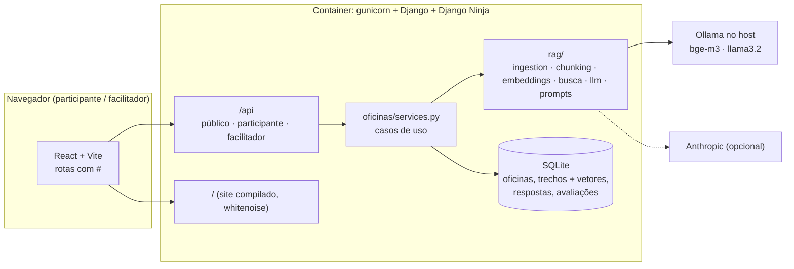

# Educagente

Plataforma da oficina **"Inclusão digital crítica: uso consciente de IA com RAG e NotebookLM"**
(Projeto DAC). Mostra, na prática, que uma IA pode responder com segurança e estar errada, e
que fontes confiáveis e verificação mudam o resultado. Público: adolescentes e adultos, sem
conhecimento técnico, em oficinas de 30 a 60 minutos.

## O que a pessoa faz

| Etapa | Atividade | O que aprende |
|---|---|---|
| 1 · Sem contexto | Faz as **três perguntas** da oficina a uma IA com configuração já definida pela equipe, sem materiais | Uma resposta convincente pode estar errada ou sem como ser conferida |
| 2 · Fontes | Adiciona fontes confiáveis (sugeridas pelo facilitador, PDF/TXT próprio ou texto colado) e, se quiser, orienta a IA | O papel do contexto, das instruções e da qualidade das fontes |
| 3 · Com fontes | Repete as **mesmas três perguntas**; cada resposta cita documento e página | Como o RAG recupera trechos; "não encontrei nas fontes" é uma resposta válida |
| 4 · Comparar | Vê as duas respostas lado a lado, avalia cada uma e diz em qual confiaria; depois vê a resposta de referência do facilitador | Conferir respostas e fontes; os limites da IA |
| 5 · NotebookLM | Passo a passo para estudar com documentos no NotebookLM (exemplo: função exponencial) | Levar o mesmo raciocínio para o estudo do dia a dia |

A página **"Como a IA usa fontes"** explica, em linguagem acessível, a diferença entre dar
contexto e RAG, o caminho de uma pergunta (trechos → embeddings → busca → resposta citando) e
tem uma simulação interativa da busca.

### Para adolescentes e adultos

Em **Ajustes de leitura** cada pessoa escolhe o tamanho do texto (normal, grande, muito
grande), fundo claro ou escuro e o nível das explicações: **o essencial** ou **com detalhes
técnicos** (similaridade de cada trecho, instruções exatas enviadas à IA, termos como
embedding e cosseno). A oficina é dividida em cinco etapas curtas, com o estado de cada uma
escrito na trilha lateral, e nada depende só de cor.

### O facilitador

Entra com a senha definida no servidor e:

- cria a oficina com **exatamente três perguntas** e, para cada uma, uma resposta de
  referência com a fonte (o participante só vê depois de avaliar sozinho);
- envia **fontes sugeridas** (PDF/TXT conferidos) que os participantes adicionam com um clique;
- mostra o **código de 6 letras** em tela cheia no projetor e fecha a oficina quando todos entraram;
- acompanha as respostas e avaliações da turma (atualiza sozinho) e **exporta CSV** para a pesquisa;
- tem o **roteiro da apresentação de 10 minutos** e os cuidados antes de começar.

`python manage.py criar_oficina_exemplo` cria uma oficina pronta sobre Napoleão Bonaparte
(três perguntas, referências e uma fonte com os fatos conferidos) para ensaiar.

## Privacidade e segurança

- O participante informa só um **apelido** e aceita um termo explícito. Ele recebe um token
  aleatório (guardado no navegador; no banco fica só o hash). Não há ids sequenciais nas URLs.
- O participante pode **apagar todos os seus dados** no fim da oficina; o facilitador também
  pode apagar um participante ou a oficina inteira.
- Os arquivos enviados **não são guardados**: só o texto extraído, cortado em trechos, e os
  embeddings, no SQLite.
- Painel do facilitador protegido por senha (`FACILITADOR_SENHA`), token assinado com validade
  de 12 h, guardado só na aba (`sessionStorage`). Login limitado a 5 tentativas por minuto.
- Limites: arquivos até 5 MB e 60 páginas, 6 fontes por pessoa, 15 perguntas por minuto por
  participante.

## Arquitetura



- `rag/` não depende de Django: extração de PDF/TXT em memória, corte em trechos por
  parágrafo, embeddings (`ollama` com bge-m3, ou `local` para demonstração), busca por cosseno
  com limiar e adaptadores de chat (Ollama, Anthropic, demonstração).
- Quando nenhum trecho passa do limiar, a IA **não é chamada**: a plataforma responde que as
  fontes não falam do assunto.
- Os vetores ficam no SQLite (sem arquivo de índice nem trava de arquivo), então funciona igual
  em Linux, macOS e Windows, e apagar um participante apaga tudo dele.

```
backend/
  educagente/   settings, urls (API + site), erros → 400/404/503
  oficinas/     modelos, services.py (regras), api.py (rotas Ninja), exemplos/, comando de exemplo
  rag/          núcleo RAG sem Django
  tests/        fluxo, segurança/isolamento e núcleo RAG (sem chamar IA de verdade)
frontend/src/
  App.tsx       cabeçalho, avisos e rotas
  paginas/      Inicio, Entrar, Oficina (+ oficina/ etapas), ComoFunciona, facilitador/
  components/   ui.tsx (botões, campos, avisos), RespostaIA.tsx (resposta + fontes), Cabecalho.tsx
  lib/          api.ts, rota.ts, preferencias.tsx, etapas.ts
```

## Como subir

### Docker (recomendado para o laboratório)

```bash
cp backend/.env.example backend/.env    # e preencha FACILITADOR_SENHA
ollama pull bge-m3 && ollama pull llama3.2:3b
./docker-up.sh
```

Tudo fica em `http://localhost:8000`. Os outros computadores acessam pelo IP da máquina do
facilitador: coloque esse IP (ou `*`) em `DJANGO_ALLOWED_HOSTS` e libere a porta 8000 no firewall.

No Windows e no macOS (Docker Desktop), o container só alcança o Ollama se ele escutar em todas
as interfaces: defina a variável de sistema `OLLAMA_HOST=0.0.0.0` (no Windows:
`setx OLLAMA_HOST 0.0.0.0`) e reinicie o Ollama. No Linux o `docker-up.sh` faz isso sozinho.

A conexão no laboratório é HTTP simples: use só em rede local confiável. Para expor na
internet, coloque um proxy com HTTPS na frente.

### Local, sem Docker

```bash
./iniciar.sh                                               # API na 8000 + Vite na 5173
MODEL_PROVIDER=demo EMBEDDING_PROVIDER=local ./iniciar.sh  # sem Ollama nem chave, só para ensaiar
```

### Configuração (`backend/.env`)

| Variável | Para quê |
|---|---|
| `FACILITADOR_SENHA` | Senha do painel (mínimo 12 caracteres). Vazia = painel desligado |
| `MODEL_PROVIDER` | `ollama`, `anthropic` ou `demo` (escolha da equipe; o participante não escolhe) |
| `LLM_MODEL` | Ex.: `llama3.2:3b` (Ollama) ou `claude-haiku-5-5` (Anthropic) |
| `ANTHROPIC_API_KEY` | Só com `MODEL_PROVIDER=anthropic` |
| `EMBEDDING_PROVIDER` | `ollama` (bge-m3) ou `local` (demonstração, sem serviço) |
| `TOP_K`, `SIMILARITY_THRESHOLD` | Quantos trechos vão para a IA e a similaridade mínima |
| `DJANGO_SECRET_KEY`, `DJANGO_ALLOWED_HOSTS`, `DJANGO_DEBUG` | Django |

Nunca commite o `.env`.

### Testes

```bash
cd backend && DJANGO_DEBUG=1 .venv/bin/python manage.py test     # Windows: .venv\Scripts\python
cd frontend && npm run build && npm run lint
```

## Antes de cada oficina

- Teste as três perguntas com o modelo configurado: não dá para supor que a etapa 1 sempre erra
  nem que a etapa 3 sempre acerta.
- O dado de "70% dos jovens usam IA" citado na concepção do projeto **ainda não tem fonte
  confirmada**: não use na apresentação até confirmar.
- Pendências da proposta que continuam com a equipe: público e local de cada oficina, escolha
  final das perguntas, cronograma e divisão de tarefas.
