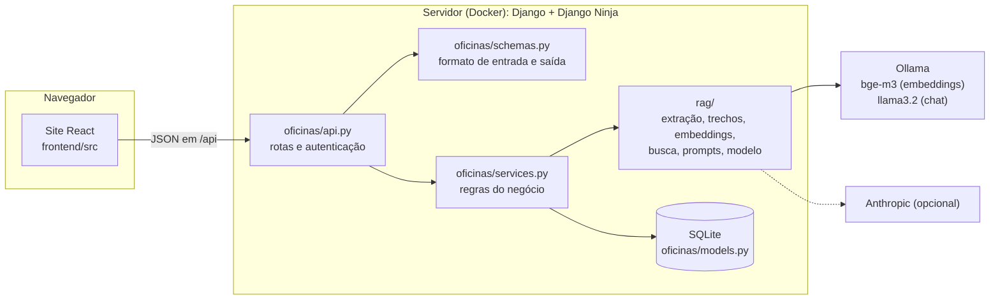
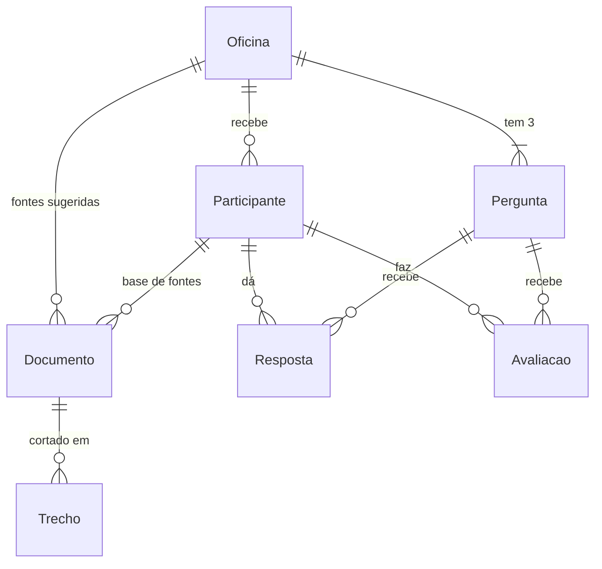

# Guia do código: como o Educagente funciona por dentro

Este guia explica cada parte da plataforma para quem vai apresentar o projeto e responder
perguntas. Ele segue o caminho dos dados: o que **entra**, como é **processado**, onde é
**guardado** e o que **sai**. Os nomes entre crases são arquivos e funções reais do repositório.

## Sumário

1. [Visão geral em 1 minuto](#1-visão-geral-em-1-minuto)
2. [Arquitetura](#2-arquitetura)
3. [O caminho de uma pergunta, passo a passo](#3-o-caminho-de-uma-pergunta-passo-a-passo)
4. [O caminho de uma fonte (PDF, TXT ou texto colado)](#4-o-caminho-de-uma-fonte-pdf-txt-ou-texto-colado)
5. [O núcleo RAG, etapa por etapa](#5-o-núcleo-rag-etapa-por-etapa)
6. [O modelo de IA e as instruções que ele recebe](#6-o-modelo-de-ia-e-as-instruções-que-ele-recebe)
7. [Banco de dados](#7-banco-de-dados)
8. [A API: entradas e saídas](#8-a-api-entradas-e-saídas)
9. [O frontend](#9-o-frontend)
10. [Segurança e LGPD](#10-segurança-e-lgpd)
11. [Testes](#11-testes)
12. [Configuração e como subir](#12-configuração-e-como-subir)
13. [Perguntas que a banca ou os alunos podem fazer](#13-perguntas-que-a-banca-ou-os-alunos-podem-fazer)

---

## 1. Visão geral em 1 minuto

A plataforma segue a proposta do projeto: mostrar, por comparação, que uma IA pode responder com
segurança e estar errada, e que fontes confiáveis mudam o resultado.

| Etapa | O participante faz | O sistema faz |
|---|---|---|
| 1. Sem contexto | Faz as 3 perguntas da oficina | Manda só a pergunta ao modelo, com uma instrução mínima |
| 2. Fontes | Adiciona PDF, TXT, texto colado ou fonte sugerida; pode orientar a IA | Extrai o texto, corta em trechos, gera embeddings e guarda no banco |
| 3. Com fontes | Repete as mesmas 3 perguntas | Busca os trechos mais parecidos e entrega só eles ao modelo (RAG) |
| 4. Comparar | Avalia as duas respostas; depois vê a referência do facilitador | Guarda a avaliação para a pesquisa |
| 5. NotebookLM | Aprende a estudar com fontes no dia a dia | Conteúdo estático; pode apagar os próprios dados |

O facilitador (professor) cria a oficina, cadastra as 3 perguntas com respostas de referência,
envia fontes sugeridas, acompanha a turma e exporta CSV.

---

## 2. Arquitetura



**Regra de ouro da organização:** cada camada só conhece a de baixo.

| Camada | Pasta | Responsabilidade | Não faz |
|---|---|---|---|
| Interface | `frontend/src/` | Telas, cliques, mostrar respostas | Nenhuma regra de negócio: sempre pergunta ao servidor |
| Rotas | `backend/oficinas/api.py` | Recebe HTTP, confere quem é, aplica limite de uso, chama a regra | Não acessa banco direto nem chama IA |
| Contratos | `backend/oficinas/schemas.py` | Define e valida os campos de entrada e saída | Não tem lógica |
| Regras | `backend/oficinas/services.py` | Todas as decisões: quem pode o quê, limites, ordem das etapas | Não sabe nada de HTTP |
| Núcleo RAG | `backend/rag/` | Extrair texto, cortar, vetorizar, buscar, montar prompt, chamar modelo | Não depende do Django (pode ser reaproveitado) |
| Dados | `backend/oficinas/models.py` | Tabelas e relações | |

Erros seguem o mesmo caminho: as regras levantam `NaoEncontrado`, `EntradaInvalida` ou
`ServicoIndisponivel` (`backend/educagente/erros.py`) e `backend/educagente/api.py` transforma em
HTTP 404, 400 ou 503 com uma mensagem pronta para o participante ler.

---

## 3. O caminho de uma pergunta, passo a passo

Exemplo: o participante clica em **"Perguntar com as fontes"** na etapa 3.

**No navegador**

1. `paginas/oficina/Perguntas.tsx`, função `perguntar(p)`: marca a pergunta como pendente e a tela
   mostra o componente `Escrevendo` (pontinhos, esqueleto e relógio em segundos).
2. `lib/api.ts`, `api.perguntar(id, 2)`: faz `POST /api/eu/perguntar` com
   `{"pergunta_id": 7, "tentativa": 2}` e o cabeçalho `X-Participante: <token>`.

**No servidor**

3. `oficinas/api.py`, rota `perguntar`. Antes de entrar na função:
   - `TokenDoParticipante` calcula o SHA-256 do token e procura o participante (`services.participante_por_token`). Não achou: **401**.
   - O limite de uso permite 15 perguntas por minuto por participante. Passou disso: **429**.
4. `services.perguntar(participante, pergunta_id, tentativa)`:
   - `_pergunta_da_oficina`: a pergunta precisa ser da oficina do participante (senão **404**).
   - `_exigir_pre_requisitos_da_segunda_tentativa`: precisa ter feito a tentativa 1 e ter pelo menos uma fonte (senão **400** com a explicação).
   - `_buscar_trechos`: carrega os trechos **só da base deste participante**, gera o embedding da pergunta e chama `rag.busca.mais_parecidos` (até 4 trechos com similaridade de pelo menos 0,5).
   - Nenhum trecho passou do limiar? A resposta é o texto fixo `NADA_RELEVANTE` ("Não encontrei nada sobre essa pergunta nas fontes...") e **o modelo nem é chamado**.
   - Achou trechos: `rag.prompts.sistema_com_fontes` monta as instruções e `_consultar_modelo` chama o adaptador de IA configurado.
   - `Resposta.objects.update_or_create` grava texto, trechos usados, se achou algo, as instruções enviadas e o tempo.
5. A rota devolve um `RespostaOut` em JSON:
   ```json
   {
     "id": 31, "pergunta_id": 7, "tentativa": 2,
     "texto": "A operadora precisa guardar os registros de conexão por 1 ano [1]...",
     "trechos": [{"documento": "direitos-digitais.txt", "pagina": 1, "similaridade": 0.71, "texto": "A operadora de internet guarda os registros de conexão por 1 ano..."}],
     "nada_relevante": false,
     "instrucoes_enviadas": "Você é um assistente de estudo...",
     "tempo_segundos": 12.4,
     "criado_em": "2026-11-02T14:03:00-04:00"
   }
   ```

**De volta ao navegador**

6. `Perguntas.tsx` chama `recarregar()`, que busca `GET /api/eu` e atualiza tudo: a resposta
   aparece (`components/RespostaIA.tsx`) com o selo "Com fontes: N trechos", os números `[1]`
   viram botões, e a barra lateral (`components/Trilha.tsx`) recalcula o progresso.

A tentativa 1 é igual, mas pula a busca: o modelo recebe só `SISTEMA_SEM_CONTEXTO` e a pergunta.

---

## 4. O caminho de uma fonte (PDF, TXT ou texto colado)

1. **Entrada:** `POST /api/eu/documentos` (arquivo) ou `POST /api/eu/textos` (`{titulo, texto}`).
2. `oficinas/api.py` confere o tamanho (até 5 MB) antes de ler o arquivo.
3. `services.adicionar_arquivo`:
   - `_checar_espaco_na_base`: no máximo 6 fontes por pessoa.
   - `_nome_limpo`: guarda só o nome do arquivo (o navegador pode mandar `C:\Users\...`).
   - `_ler_arquivo` chama `rag.ingestion.extrair_paginas`: o PDF é lido **em memória**, página por página. O arquivo original **nunca é salvo em disco**.
4. `_cortar_em_trechos` confere se há texto (PDF escaneado não tem) e se não passa de 200 mil caracteres, e chama `rag.chunking.dividir_em_trechos`.
5. `_exigir_espaco_para_trechos`: se a base passaria de 600 trechos, recusa **antes** de gravar.
6. `_gravar_documento`: gera os embeddings de todos os trechos de uma vez e grava `Documento` + `Trecho` numa transação (ou grava tudo, ou nada).
7. **Saída:** `DocumentoOut` com nome, origem, páginas e quantidade de trechos.

**Fonte sugerida pelo facilitador:** `adicionar_fonte_sugerida` só **copia** os trechos e vetores
que já existem. Não gera embedding de novo, por isso é instantâneo.

---

## 5. O núcleo RAG, etapa por etapa

RAG (*Retrieval-Augmented Generation*, geração aumentada por recuperação) é: antes de responder,
**recuperar** trechos relevantes de documentos e **entregar** esses trechos ao modelo.

| Etapa | Arquivo e função | Entra | Sai | Parâmetros |
|---|---|---|---|---|
| 1. Extração | `rag/ingestion.py` `extrair_paginas` | nome + bytes do arquivo | lista de `PaginaExtraida(pagina, texto)` | PDF até 60 páginas; TXT em UTF-8 ou ANSI (Bloco de Notas) |
| 2. Corte em trechos | `rag/chunking.py` `dividir_em_trechos` | texto de uma página | lista de trechos | até 500 caracteres; parágrafos curtos se juntam; sobreposição de 60 ao cortar parágrafo longo |
| 3. Embeddings | `rag/embeddings.py` `gerar_embeddings` | lista de textos | matriz de números (float32) | `bge-m3` via Ollama (multilíngue); ou `local` (só para demonstração) |
| 4. Busca | `rag/busca.py` `mais_parecidos` | vetor da pergunta + vetores dos trechos | posições e similaridades | `TOP_K=4`, `SIMILARITY_THRESHOLD=0.5` |
| 5. Prompt | `rag/prompts.py` `sistema_com_fontes` | orientação + trechos | texto das instruções | trechos numerados com documento e página |
| 6. Geração | `rag/llm.py` `criar_adaptador(...).conversar` | instruções + pergunta | `RespostaDoModelo` | até 700 tokens de resposta |

### Por que cada escolha

- **Cortar em trechos:** o modelo responde melhor com poucos trechos certeiros do que com o documento inteiro, e a citação aponta para uma ideia só.
- **Embedding:** transforma o texto numa lista de números que representa o **significado**. Textos sobre o mesmo assunto ficam com vetores parecidos, mesmo usando palavras diferentes. O `bge-m3` foi escolhido por funcionar bem em português.
- **Similaridade de cosseno:** mede o ângulo entre dois vetores. 1 é "mesmo sentido", perto de 0 é "nada a ver". A fórmula está em `rag/busca.py`: `matriz @ consulta / (normas)`.
- **Limiar (0,5):** se nem o melhor trecho for parecido o bastante, a plataforma **admite que não encontrou** em vez de forçar uma resposta com contexto fraco. Isso é parte da lição da oficina.
- **Vetores no SQLite:** cada trecho guarda seu vetor como bytes (`Trecho.vetor`). Para uma turma (centenas de trechos por pessoa), comparar tudo com numpy é instantâneo e dispensa um banco vetorial à parte.

### Modo "local" de embeddings

`EMBEDDING_PROVIDER=local` usa um "saco de palavras com hash" (`_saco_de_palavras`): aproxima
textos que têm palavras em comum. Serve para ensaiar sem Ollama e para os testes, **não** para
avaliar a qualidade da busca.

---

## 6. O modelo de IA e as instruções que ele recebe

### Adaptadores (`rag/llm.py`)

Todos têm a mesma interface, `conversar(sistema, pergunta) -> RespostaDoModelo`. Trocar de
modelo é só mudar o `.env`; o resto do código não muda.

| Adaptador | Quando é usado | Onde roda |
|---|---|---|
| `AdaptadorOllama` | `MODEL_PROVIDER=ollama` | Na máquina do professor ou no servidor: **nada sai da rede** |
| `AdaptadorAnthropic` | `MODEL_PROVIDER=anthropic` + `ANTHROPIC_API_KEY` | Nos servidores da Anthropic (internet) |
| `AdaptadorDemonstracao` | `MODEL_PROVIDER=demo`, ou Anthropic sem chave | Sem IA nenhuma: devolve um texto fixo ou o começo do primeiro trecho |

Falhas do provedor (fora do ar, chave inválida, muitas perguntas) viram `FalhaDoProvedor` com
uma mensagem pronta e o participante vê um aviso, não um erro técnico.

### As instruções (`rag/prompts.py`)

**Tentativa 1 (sem contexto):**
> Você é um assistente. Responda em português do Brasil, em até dois parágrafos curtos.

**Tentativa 2 (com fontes):** três blocos, nesta ordem:
1. `SISTEMA_COM_FONTES`: responder **somente** com os trechos, citar `[n]`, dizer quando as fontes não falam do assunto e não completar com conhecimento próprio.
2. `ORIENTAÇÃO DO ESTUDANTE:` o que o participante escreveu na etapa 2 (opcional).
3. `TRECHOS DAS FONTES:` cada trecho numerado, com documento e página.

No modo "Com detalhes técnicos", o participante vê exatamente esse texto em
"Ver as instruções exatas enviadas à IA". Nada fica escondido.

---

## 7. Banco de dados

SQLite em `backend/data/educagente.sqlite3`, modelos em `backend/oficinas/models.py`.



| Tabela | Campos principais | Observações |
|---|---|---|
| `Oficina` | titulo, codigo, aberta, criado_em | Código de 6 caracteres sem 0, O, 1, I, L (fácil de ler no projetor) |
| `Pergunta` | oficina, ordem (1 a 3), texto, referencia | A referência só aparece ao participante depois que ele avalia |
| `Participante` | oficina, apelido, token_hash, orientacao | Só o **hash** do token; nenhum dado pessoal além do apelido |
| `Documento` | oficina **ou** participante, nome, origem, paginas, copia_de | Uma regra no banco garante que pertence a um dos dois, nunca aos dois |
| `Trecho` | documento, pagina, texto, vetor | O vetor do embedding em bytes (float32) |
| `Resposta` | participante, pergunta, tentativa (1 ou 2), texto, trechos, nada_relevante, instrucoes_enviadas, tempo_segundos | Uma por participante, pergunta e tentativa; perguntar de novo substitui |
| `Avaliacao` | participante, pergunta, primeira, segunda, mais_confiavel, conferiu_fonte, observacao | Uma por participante e pergunta |

**Apagar em cascata:** apagar uma oficina apaga participantes, fontes, trechos, respostas e
avaliações; apagar um participante apaga tudo o que é dele. Isso sustenta o direito de exclusão
da LGPD. A exceção é `copia_de`: se o facilitador remove uma fonte sugerida, as cópias que os
participantes já usaram continuam, para que as respostas antigas sigam explicáveis.

---

## 8. A API: entradas e saídas

Todas as rotas começam com `/api`. Os formatos estão em `backend/oficinas/schemas.py` e o
frontend espelha os mesmos tipos em `frontend/src/lib/api.ts`.

| Quem | Método e caminho | Entrada | Saída |
|---|---|---|---|
| Público | `GET /saude` | | modelo, modo demonstração, facilitador configurado |
| Público | `GET /oficinas/{codigo}` | | título, código, se está aberta |
| Público | `POST /oficinas/{codigo}/entrar` | apelido, consentimento | **token** do participante + estado inicial |
| Público | `POST /facilitador/entrar` | senha | **token** do facilitador (12 h) |
| Participante | `GET /eu` | | estado completo: perguntas, fontes, respostas, avaliações, referências liberadas |
| Participante | `POST /eu/perguntar` | pergunta_id, tentativa | resposta (seção 3) |
| Participante | `POST /eu/documentos` | arquivo PDF/TXT | documento criado |
| Participante | `POST /eu/textos` | titulo, texto | documento criado |
| Participante | `POST /eu/fontes-sugeridas/{id}` | | cópia da fonte na base |
| Participante | `DELETE /eu/documentos/{id}` | | 204 |
| Participante | `PUT /eu/orientacao` | orientacao | 204 |
| Participante | `PUT /eu/avaliacoes/{pergunta_id}` | primeira, segunda, mais_confiavel, conferiu_fonte, observacao | avaliação salva |
| Participante | `DELETE /eu` | | 204: apaga **todos** os dados do participante |
| Facilitador | `GET/POST /facilitador/oficinas` | título + 3 perguntas | lista / oficina criada |
| Facilitador | `GET/PATCH/DELETE /facilitador/oficinas/{id}` | título, aberta, perguntas | detalhe com relatório da turma |
| Facilitador | `POST/DELETE .../{id}/fontes[/{fonte_id}]` | arquivo | fonte sugerida |
| Facilitador | `DELETE .../{id}/participantes/{pid}` | | 204 |
| Facilitador | `GET .../{id}/export.csv` | | CSV (uma linha por participante e pergunta) |

**Códigos de resposta:** 200/204 sucesso · 400 pedido que a pessoa pode corrigir · 401 sem login
· 404 não existe ou é de outra pessoa · 422 campo fora do formato · 429 muitas tentativas · 503
IA ou embeddings fora do ar. Com `DJANGO_DEBUG=1`, a documentação interativa fica em `/api/docs`.

O CSV é gerado em `backend/oficinas/exportacao.py`. Toda célula que começa com `=`, `+`, `-` ou
`@` ganha um apóstrofo na frente, para o Excel não executar fórmulas escritas por participantes.

---

## 9. O frontend

React 19 + Vite + TypeScript + Tailwind. Sem biblioteca de rotas nem de animação: o mínimo
necessário para rodar em PCs antigos.

### Organização (`frontend/src/`)

| Pasta ou arquivo | O que tem |
|---|---|
| `main.tsx`, `App.tsx` | Monta o site, verifica `/api/saude`, escolhe a página pela rota |
| `lib/api.ts` | Cliente da API: uma função por rota, tokens, mensagens de erro legíveis |
| `lib/rota.ts` | Rotas com `#` (ex.: `#/oficina/3`): voltar e recarregar funcionam em qualquer servidor |
| `lib/etapas.ts` | As 5 etapas e o cálculo do progresso a partir do estado |
| `lib/preferencias.ts` + `ProvedorDePreferencias.tsx` | Ajustes de leitura (tamanho, tema, nível de detalhe) |
| `components/ui.tsx`, `classes.ts` | Peças reutilizáveis: Botao, Aviso, Dica, Campo, Segmentado, Caixa |
| `components/RespostaIA.tsx` | Resposta com selo de procedência, citações clicáveis e trechos |
| `components/Trilha.tsx`, `Etapa.tsx` | Barra lateral de progresso; cabeçalho e botão "avançar" das etapas |
| `paginas/` | Início, Entrar, Oficina (e as 5 etapas em `oficina/`), Como funciona, Facilitador |

### Como o estado funciona

`paginas/Oficina.tsx` guarda o **estado do participante** que vem de `GET /api/eu`. As etapas
nunca alteram esse estado por conta própria: depois de qualquer ação (perguntar, enviar fonte,
avaliar) elas chamam `recarregar()`, e tudo é redesenhado com o que o servidor devolveu. **O
servidor é a única fonte da verdade**; o navegador só mostra.

### Onde ficam os tokens no navegador

- Participante: `localStorage` (sobrevive a recarregar; o progresso não se perde).
- Facilitador: `sessionStorage` (some ao fechar a aba, porque o PC da escola é compartilhado).
- Nenhum dos dois é a senha nem um número em sequência.

### Ajustes de leitura (adolescentes e adultos)

- **Tamanho do texto:** muda o tamanho base no `<html>`; tudo cresce junto.
- **Tema:** claro (padrão, pensado para projetor) ou escuro; as cores são variáveis em `index.css`.
- **Explicações:** "O essencial" ou "Com detalhes técnicos" (similaridade, instruções enviadas, termos como embedding).

### Animações

Todas em CSS (`index.css`) e desligadas automaticamente para quem pede menos movimento no sistema.
A principal é o **marca-texto** (`.marca-texto`): o realce amarelo "passa" sobre o trecho da fonte
que sustenta a resposta, a ideia central da oficina em forma visual.

---

## 10. Segurança e LGPD

| Tema | Como está resolvido | Onde |
|---|---|---|
| Identificação mínima | Só apelido + termo de consentimento explícito | `Entrar.tsx`, `services.entrar` |
| Token do participante | Aleatório (256 bits); o banco guarda só o SHA-256 | `services.entrar`, `hash_do_token` |
| Isolamento | Toda consulta parte do participante logado; o que é de outra pessoa dá 404 | `services.py` (testes em `test_seguranca.py`) |
| Senha do facilitador | Mínimo 12 caracteres, comparação segura, 5 tentativas por minuto, token assinado de 12 h | `settings.py`, `services.entrar_como_facilitador` |
| Arquivos | Lidos em memória, nunca salvos; limite de 5 MB, 60 páginas, 6 fontes, 600 trechos | `rag/ingestion.py`, `services.py` |
| Exclusão | Participante apaga os próprios dados; facilitador apaga participante ou oficina (em cascata) | `DELETE /eu`, rotas do facilitador |
| CSV | Fórmulas neutralizadas | `exportacao.py` |
| Produção | DEBUG desligado, chave secreta obrigatória, `/api/docs` desligado, HTTPS pelo Caddy | `settings.py`, `docker-compose.prod.yml` |

**Cuidados que dependem do uso:**
- No laboratório a conexão é HTTP (sem criptografia): use só em rede confiável.
- Com `MODEL_PROVIDER=anthropic`, perguntas, trechos e orientações vão para a Anthropic. Com Ollama, nada sai da máquina; com menores de idade, prefira Ollama.
- Os dados ficam até alguém apagar: depois de exportar o CSV, apague a oficina.
- Em PC compartilhado, peça para cada aluno usar "Apagar meus dados" no fim.

---

## 11. Testes

`backend/tests/` tem 40 testes automáticos que rodam **sem IA de verdade**: os embeddings usam o
modo `local` e o modelo é substituído por `ModeloFalso` (`tests/apoio.py`).

| Arquivo | O que garante |
|---|---|
| `test_fluxo.py` | A ordem da proposta (tentativa 2 exige a 1 e uma fonte), citação de documento e página, "nada relevante" sem chamar o modelo, referência só depois de avaliar, limites e formatos de arquivo |
| `test_seguranca.py` | Rotas exigem login, um participante não mexe no que é do outro, token guardado como hash, limite de tentativas, oficina fechada, exclusão de dados, CSV seguro |
| `test_rag.py` | Corte em trechos, busca com limiar, vetor zerado, formato não suportado |

Rodar: `cd backend && DJANGO_DEBUG=1 .venv/bin/python manage.py test`. Para um servidor no ar,
`./testar-producao.sh <endereço>` faz o caminho completo com IA de verdade e apaga tudo no fim.

---

## 12. Configuração e como subir

Toda a configuração fica em `backend/.env` (modelo em `backend/.env.example`). As principais:

| Variável | Para quê |
|---|---|
| `FACILITADOR_SENHA` | Senha do professor (mínimo 12 caracteres) |
| `MODEL_PROVIDER`, `LLM_MODEL` | Qual IA responde: `ollama` + `llama3.2:3b`, ou `anthropic` + `claude-haiku-5-5` |
| `EMBEDDING_PROVIDER`, `EMBEDDING_MODEL` | Busca nas fontes: `ollama` + `bge-m3` |
| `TOP_K`, `SIMILARITY_THRESHOLD` | Quantos trechos vão para a IA e a similaridade mínima |
| `DJANGO_SECRET_KEY`, `DJANGO_ALLOWED_HOSTS` | Segurança do Django e endereços aceitos |
| `DOMINIO` | Só para produção na internet (HTTPS) |

Formas de subir: `./instalar-linux.sh` (tudo automático no Linux), `./docker-up.sh` (Docker no
laboratório), `./iniciar.sh` (desenvolvimento) e `docker-compose.prod.yml` (internet com HTTPS).
O passo a passo está no README.

---

## 13. Perguntas que a banca ou os alunos podem fazer

**A IA aprende com as perguntas dos alunos?**
Não. O modelo não é treinado nem ajustado pela plataforma. Cada pergunta é independente; o que
muda a resposta são as instruções e os trechos enviados naquele momento.

**Qual a diferença entre anexar um arquivo no ChatGPT e o que vocês fazem?**
Anexar é dar contexto: o modelo recebe o documento como veio. Aqui a plataforma corta as fontes
em trechos, escolhe só os mais parecidos com a pergunta e mostra de qual documento e página veio
cada informação. Isso é RAG.

**Se a fonte estiver errada, a resposta fica certa?**
Não. A IA confia no que recebe. Por isso a etapa 4 pede para conferir e mostra a resposta de
referência do facilitador.

**Por que às vezes aparece "não encontrei nas fontes"?**
Porque nenhum trecho atingiu a similaridade mínima (0,5). Preferimos admitir do que inventar.

**Onde ficam os dados dos alunos? Quem vê?**
No banco SQLite da máquina que roda a plataforma. Só o facilitador, com senha, vê as respostas
da turma. Com Ollama, nada sai dessa máquina.

**Por que Ollama e não ChatGPT?**
Roda localmente, de graça e sem enviar dados de alunos para fora. A plataforma também aceita a
Anthropic se a equipe quiser; é só mudar o `.env`.

**Por que SQLite e não um banco vetorial?**
O volume de uma oficina é pequeno (centenas de trechos por pessoa). Comparar todos os vetores com
numpy leva milissegundos, e um arquivo só é mais simples de instalar, copiar e apagar.

**Como vocês sabem que funciona?**
40 testes automáticos cobrem o fluxo, a segurança e o RAG, e o `testar-producao.sh` confere um
servidor real de ponta a ponta.

**O NotebookLM funciona do mesmo jeito?**
Ele também responde com base nas fontes que você adiciona e mostra citações, mas os detalhes
internos dele não são públicos. O que mostramos aqui é uma versão aberta e simplificada do mesmo
princípio.
